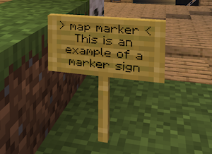
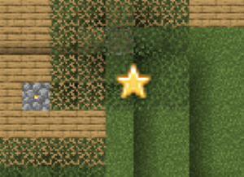
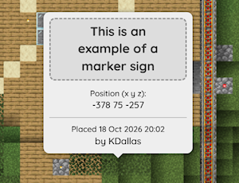
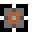
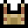
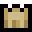
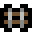
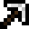
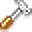
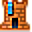

## BlueMap Sign Markers Redux

This plugin is a fork of [IMMC BlueMap Sign Markers](https://github.com/IMMC-dev/Bluemap-Sign-Markers) which forked [Easy BlueMap Sign Markers](https://github.com/deimiczny/easy-bmapmarkers), which itself is a fork of [BlueMapSignMarkers](https://modrinth.com/plugin/bluemapsignmarkers) 

### Changes in this fork

- **Renamed to `SignMarkersRedux`**, including the in-game chat prefix. Upstream called the
  plugin `IMMCBluemapSignMarkers`.
- **Builds for two Paper targets from one branch** - Paper 1.21.x on Java 21 and Paper 26.x
  on Java 25, with no second JDK needed for either. See [Building](#building).
- **Sign API modernised** - `SignChangeEvent#getLine`/`#setLine` are deprecated in favour of
  the Adventure `Component`-based `line(int)` accessors, which the plugin now uses.
- **Build brought up to Gradle 9** - bumped the foojay toolchain resolver, regenerated the
  wrapper, and removed an execution-time `project` reference that becomes an error in Gradle 10.

### Inherited from upstream

- **Custom icons** - any icon file present in `/bluemap/web/markers/` is used as-is, instead
  of the plugin requiring one of its built-in names. This is the feature the fork chain added,
  and the reason this fork exists.
- **Paper and Folia support.** No other platform (e.g. Fabric) is planned.

The usage instructions and icon list below come from the upstream readme and still apply.


## Building

Requires a JDK 25 toolchain (Gradle downloads one via the foojay resolver if absent).
No JDK 21 install is needed - the 1.21 build compiles with `--release 21` on JDK 25.

- `./gradlew build` - builds the 1.21.x target (paper-api 1.21.11, BlueMap API 2.7.7)
- `./gradlew build -PmcTarget=26` - builds the 26.x target (paper-api 26.3, BlueMap API 2.8.1)

Artifacts land in `build/libs` as `SignMarkersRedux-<version>.<build>-mc1.21.jar` and
`SignMarkersRedux-<version>.<build>-mc26.3.jar`, where `<build>` is the git commit count,
suffixed with `-dirty` when the tree has uncommitted changes. The build number appears in
the jar name only - `plugin.yml` keeps reporting the plain `<version>`.

They coexist, so run the two builds without `clean` between them if you want both.
`clean` removes both.

Everything that differs between the two targets lives in one table at the top of
`build.gradle.kts`; adding a third target means adding one entry there.


## How to use
Place any sign in the game. Fill the sign as follows:

- **1st line**: `[marker_icon_name]`
- **2nd line:** text
- **3rd line:** text
- **4th line:** text

### Icon resolution

Icons live in `/bluemap/web/markers/`. They may sit directly in that folder or in one level of
sub-folder (`web/markers/set05/`). PNG, SVG and WebP all work. The bundled sets use the same
lookup as your own icons: the plugin copies them into `web/markers/set1/` and `set2/` on start,
and an existing file is never overwritten.

Lookup order:

1. **Format** - `.svg`, then `.webp`, then `.png`. Format outranks folder, so a `portal.svg` in
   `set2/` beats a `portal.png` in the root.
2. **Folder** - the `markers/` root first, then its sub-folders in case-insensitive natural
   order (`set1`, `set2`, ..., `set10`), stopping at the first file hit.

So within one folder `[portal]` uses `portal.svg` if present, then `portal.webp`, then
`portal.png`; two files of the same format are settled by folder.

- `[portal.svg]` uses that exact file. An explicit name always wins over the format order, so
  `[portal.png]` picks the PNG even when an SVG of the same name is present.
- `[set2/tree]` searches only `set2/`, skipping the folder order; the usual format order still
  applies within it. The prefix must be a direct sub-folder of `markers/`; if that folder or file
  is missing, the fallback icon is used rather than trying elsewhere.
- `[portal]` still matches a file whose own name contains a dot (`my.icon.png` for `[my.icon]`)
  after the extension probes, as it did before SVG support.
- If nothing matches, the bundled `ban_white` icon is used.
- The token is case-insensitive, but file and folder names must be lower-case on case-sensitive
  filesystems.

Format is compared before folder, so an icon in `web/markers/` only wins over a bundled file of
the *same* format: a root `portal.png` does not shadow a bundled `portal.webp`. To replace a
bundled icon outright, put the same format in the root, or use an SVG or WebP there.

An SVG should carry explicit `width` and `height` attributes; those are used exactly as written.
A `viewBox` is only consulted when neither is available, and is scaled down so its longest edge is
at most 50px - viewBox numbers are usually far larger than an icon renders, so they are not used
as pixel sizes directly. PNG and WebP sizes are read from their headers, so their anchors are the
icon's centre.

### Adding your own icon set

Create a folder inside `/bluemap/web/markers/` and put icons in it - no registration, restart or
configuration needed:

```text
web/markers/custom1/portal.webp
web/markers/custom1/harbour.svg
```

`[portal]` and `[harbour]` then resolve from `custom1/`. To bypass the folder order entirely,
prefix the name with the folder: `[custom1/harbour]`. A few consequences of the lookup order
above:

- Only direct sub-folders of `markers/` are searched; `custom1/deep/icon.png` is not found.
- A folder's name is its position in the tie-break. `custom1` sorts before `set1`, so it wins
  same-format ties against the bundled sets. A name that sorts after them (e.g. `zcustom`) only
  wins ties where no bundled folder holds that icon.
- To override one bundled icon rather than a whole set, either put the file directly in
  `web/markers/` in the same format, or use a higher-priority format anywhere (`portal.svg` beats
  `portal.webp`, which beats `portal.png`).
- The plugin only copies its own `set1`/`set2` into `web/markers/` and never overwrites an
  existing file, so your folders are safe. Delete a bundled `setN/` folder to have it recreated
  from the jar on the next start.

Icons are resolved when a sign is placed, so a newly added file is used by the next sign without
any reload. For an existing marker, `/signmarkers regenerate <id or label>` re-reads its sign and
resolves the icon again.

## Example

The example below creates a marker on your map with the `star` icon assigned.

First, you build the sign


After you complete it, the first line will switch to `> map marker <`. This indicates that placing
the marker was successful.



After a while, you will see the marker on your BlueMap



And when you click it, the popup containing your sign description will appear



## Commands

`/signmarkers` manages a world's marker set. Signs create and remove markers on their own; these
are for everything else - most usefully a marker imported from a BlueMap config, which has no sign
in the world and therefore no block to break.

| Command | |
| --- | --- |
| `/signmarkers list` | List every marker in your world, flagging which have no sign behind them |
| `/signmarkers remove <id or label>` | Delete one marker |
| `/signmarkers place-sign <id or label>` | Place a sign at the marker's position, making it sign-backed |
| `/signmarkers reapply [id or label]` | Rebuild marker popups with the current template - all of them, or just one |
| `/signmarkers regenerate [id or label]` | As `reapply`, but also re-reads the sign at each marker's position |

`remove` and `place-sign` accept either the marker id or its label. Labels are matched
case-insensitively and may contain spaces; if two markers share a label the command refuses and
lists the matching ids rather than guessing which one you meant.

`place-sign` refuses to place over a non-air block, so it cannot overwrite a build. It then re-keys
the marker to the id that a block break looks for - which is what makes breaking the new sign
remove the marker rather than leaving it behind.

`reapply` and `regenerate` differ in where they get their data. `reapply` re-renders what the
marker already stores. `regenerate` first looks for a sign at the marker's position and, if there
is one, takes the icon, label and text from it - which is the only way to pick up a sign that was
edited after the marker was created, since that edit is otherwise ignored once line 0 holds the
plugin's placeholder. Where no sign exists both behave the same.

Requires the `signmarkers.admin` permission, granted to operators by default.

## Popup template

`plugins/SignMarkersRedux/template.html` controls the HTML shown when a marker is clicked. It is
written on first start and never overwritten, so edits survive upgrades. The file is re-read each
time a marker is created, so changes take effect on the next sign without a restart.

Values are substituted into `{{ name }}` placeholders and are **always HTML-escaped** - the
template is trusted markup, the sign text is not.

| Placeholder | Value |
| --- | --- |
| `{{ label }}` | the joined label, as the marker itself shows it |
| `{{ label1 }}` `{{ label2 }}` `{{ label3 }}` | the individual sign lines |
| `{{ x }}` `{{ y }}` `{{ z }}` | coordinates |
| `{{ position }}` | coordinates pre-joined as `x y z` |
| `{{ timestamp }}` | when the marker was created |
| `{{ author }}` | who created it |
| `{{ icon }}` | icon path, ready for use in `` |
| `{{ world }}` | world name |

Unknown placeholders are left as written, so a typo shows up in the popup rather than silently
vanishing.

The rendered HTML is stored on the marker at creation, so editing the template only affects
markers made afterwards. Run `/signmarkers reapply` to rebuild the existing ones in your world -
all of them, or one by id or label.

Author and date are always set to whoever runs the command and the current time, so a reapplied
marker records who last rendered it rather than its original creator. Only the individual sign
lines are restored from the marker; imported markers, which never had them, fall back to the
joined label.

The default template styles itself with BlueMap's theme variables (`--theme-fg-light`,
`--theme-bg-hover`, `--theme-bg-light`), so the popup follows the webapp's light or dark theme. Note
that a `<style>` block in the template applies document-wide while the popup is open, and is
repeated in every marker's stored detail - fine for a few dozen markers, worth trimming for
hundreds.

## Markers included by default

These are the names that are available automatically for the markers, plus the corresponding
icons. Just use any of the values between brackets - `[` and `]`, e.g. `[portal]` - to place the
marker on the **BlueMap**. It does not matter if you use lowercase or uppercase; the plugin will
handle it.

### Marker names

#### Set 1 - `set1/`

| Name              | Icon                                                                     |     | Name              | Icon                                                                     |     | Name              | Icon                                                                     |
| ----------------- | ------------------------------------------------------------------------ | --- | ----------------- | ------------------------------------------------------------------------ | --- | ----------------- | ------------------------------------------------------------------------ |
| `ancient_city`    |        |     | `ban_purple`      |            |     | `target_point`    |        |
| `ban_black`       |              |     | `ban_red`         |                  |     | `target_x`        |                |
| `ban_blue`        |                |     | `ban_white`       |              |     | `treasure_x`      |            |
| `ban_brown`       |              |     | `ban_yellow`      |            |     | `tree`            |                        |
| `ban_cyan`        |                |     | `camp`            |                        |     | `trial`           |                      |
| `ban_gray`        |                |     | `desert_temple`   |      |     | `village_desert`  |    |
| `ban_green`       |              |     | `mansion`         |                  |     | `village_plains`  |    |
| `ban_light_blue`  |    |     | `mineshaft`       |              |     | `village_savanna` |  |
| `ban_light_gray`  |    |     | `monument`        |                |     | `village_snow`    |        |
| `ban_lime`        |                |     | `ocean_ruins`     |          |     | `village_taiga`   |      |
| `ban_magenta`     |          |     | `pickaxe`         |                  |     | `witch_hut`       |              |
| `ban_orange`      |            |     | `portal`          |                    |     |                   |                                                                          |
| `ban_pink`        |                |     | `spawner`         |                  |     |                   |                                                                          |

#### Set 2 - `set2/`

| Name           | Icon                                                               |     | Name           | Icon                                                               |     | Name           | Icon                                                               |
| -------------- | ------------------------------------------------------------------ | --- | -------------- | ------------------------------------------------------------------ | --- | -------------- | ------------------------------------------------------------------ |
| `anchor`       |              |     | `down`         |                  |     | `pointup`      |            |
| `bank`         |                  |     | `drink`        |                |     | `portal`       |              |
| `basket`       |              |     | `exclamation`  |    |     | `purpleflag`   |      |
| `bed`          |                    |     | `factory`      |            |     | `queen`        |                |
| `beer`         |                  |     | `fire`         |                  |     | `redflag`      |            |
| `bighouse`     |          |     | `flower`       |              |     | `right`        |                |
| `blueflag`     |          |     | `gear`         |                  |     | `ruby`         |                  |
| `bomb`         |                  |     | `goldmedal`    |        |     | `scales`       |              |
| `bookshelf`    |        |     | `goldstar`     |          |     | `shield`       |              |
| `bricks`       |              |     | `greenflag`    |        |     | `sign`         |                  |
| `bronzemedal`  |    |     | `hammer`       |              |     | `silvermedal`  |    |
| `bronzestar`   |      |     | `heart`        |                |     | `silverstar`   |      |
| `building`     |          |     | `house`        |                |     | `skull`        |                |
| `cake`         |                  |     | `key`          |                    |     | `star`         |                  |
| `camera`       |              |     | `king`         |                  |     | `sun`          |                    |
| `cart`         |                  |     | `left`         |                  |     | `temple`       |              |
| `caution`      |            |     | `lightbulb`    |        |     | `theater`      |            |
| `chest`        |                |     | `lighthouse`   |      |     | `tornado`      |            |
| `church`       |              |     | `lock`         |                  |     | `tower`        |                |
| `coins`        |                |     | `map`          |                    |     | `tree`         |                  |
| `comment`      |            |     | `minecart`     |          |     | `truck`        |                |
| `compass`      |            |     | `offlineuser`  |    |     | `up`           |                      |
| `construction` |  |     | `orangeflag`   |      |     | `walk`         |                  |
| `cross`        |                |     | `papaj`        |                |     | `warning`      |            |
| `cup`          |                    |     | `pinkflag`     |          |     | `world`        |                |
| `cutlery`      |            |     | `pirateflag`   |      |     | `wrench`       |              |
| `diamond`      |            |     | `pointdown`    |        |     | `yellowflag`   |      |
| `dog`          |                    |     | `pointleft`    |        |     |                |                                                                    |
| `door`         |                  |     | `pointright`   |      |     |                |                                                                    |

`ban_white` is the fallback when a sign names an icon that cannot be resolved.

The set 1 icons come from the vanilla Minecraft map icons and the
[Map Icons Resource Pack](https://modrinth.com/resourcepack/map-icons), used under its MIT licence.
<br/>
The set 2 icons are modified versions of the original [Dynmap](https://github.com/webbukkit/dynmap)
assets, used under the Apache 2.0 licence.
